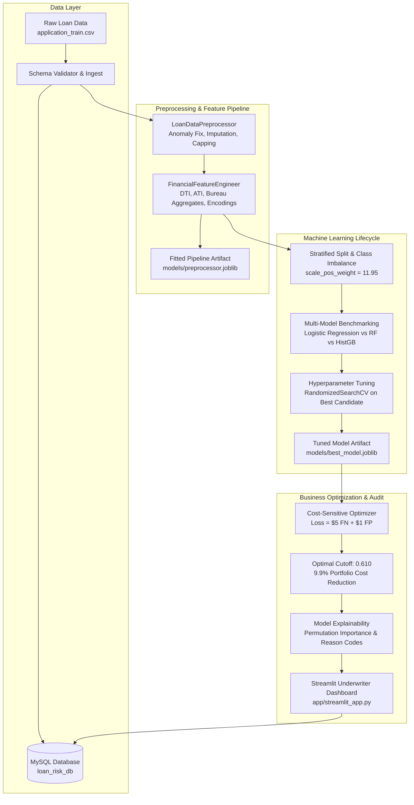

# 💳 CreditIQ | End-to-End Loan Default Prediction & Credit Risk Intelligence System

[](https://www.python.org/)
[](https://scikit-learn.org/)
[](https://www.mysql.com/)
[](https://streamlit.io/)
[](https://joblib.readthedocs.io/)
[](LICENSE)

An enterprise-grade, production-ready machine learning system for predicting consumer loan default risk and automating credit underwriting decisions. Engineered on the **Home Credit Default Risk** portfolio, CreditIQ combines advanced feature engineering, class imbalance mitigation, multi-model benchmarking, cost-sensitive threshold optimization, model interpretability, and MySQL audit persistence.

---

## 🛠️ Technology Stack

| Domain | Technology / Libraries Used | Purpose in Project |
|:---|:---|:---|
| **Programming** | **Python 3.9+** | Core development, pipeline orchestration, and REST API |
| **Data Analysis** | **Pandas, NumPy** | Data ingestion, vector transformations, financial ratios, schema validation |
| **Visualization** | **Matplotlib, Seaborn, Streamlit** | ROC/PR curves, confusion matrices, risk distributions, cost curves, UI |
| **Machine Learning** | **Scikit-learn, Imbalanced-learn** | Logistic Regression, Random Forest, HistGradientBoosting, SMOTE, CV |
| **Database** | **MySQL** (with SQLite fallback) | Relational schema, applicant storage, ratios, underwriting audit log |
| **Dashboard** | **Streamlit** (plus embedded Web UI) | Interactive underwriting simulator, portfolio analytics, audit explorer |
| **Model Persistence** | **Joblib** | Serialized preprocessor pipelines, trained models, feature names |

---

## 🏛️ System Architecture



---

## 📂 Repository Structure

```
loan-default-risk-prediction/
├── README.md                            <- Comprehensive project documentation
├── requirements.txt                     <- Project dependencies
├── setup.py                             <- Package installable specification
├── .gitignore                           <- Git exclusion rules
│
├── data/
│   ├── raw/
│   │   └── application_train.csv        <- 8,643 applicants, 122 raw features
│   ├── processed/
│   │   ├── train_preprocessed.csv       <- Preprocessed train split (6,914 rows, 140 features)
│   │   ├── test_preprocessed.csv        <- Preprocessed test split (1,729 rows, 140 features)
│   │   └── feature_names.json           <- Master list of 140 engineered feature names
│   └── loan_risk_local.db               <- Local database storage (SQLite fallback)
│
├── database/
│   ├── schema.sql                       <- Enterprise MySQL DDL schema (tables, foreign keys, views)
│   └── load_to_mysql.py                 <- ETL script populating MySQL database from raw CSV
│
├── src/
│   ├── __init__.py
│   ├── config.py                        <- Central configurations, paths, parameters, cost weights
│   ├── data_loader.py                   <- Data loading and schema validation
│   ├── preprocessor.py                  <- Anomaly handling, building reduction, median imputation, outlier capping
│   ├── feature_engineering.py           <- Financial affordability ratios, EXT_SOURCE combos, categorical encoding
│   ├── imbalance_handler.py             <- Imbalanced-learn integration (SMOTE, ADASYN, undersampling)
│   ├── models.py                        <- Model registry (Logistic Regression, Random Forest, HistGB)
│   ├── train.py                         <- End-to-end training, benchmarking, tuning, and artifact serialization
│   ├── evaluate.py                      <- ROC-AUC, PR-AUC, cost-sensitive threshold search, chart plotting
│   ├── explainability.py                <- Permutation importance, top drivers, applicant-level reason codes
│   ├── database.py                      <- MySQL connection manager, connection pooling, audit logging
│   └── predict.py                       <- Production inference engine for single/batch scoring with risk tiers
│
├── models/
│   ├── best_model.joblib                <- Trained best model artifact (Tuned Random Forest)
│   ├── preprocessor.joblib              <- Fitted preprocessing & feature transformation pipeline
│   └── metrics_summary.json             <- Benchmark metrics, optimal threshold, top features
│
├── reports/
│   ├── model_performance_report.md      <- Full technical and executive evaluation report
│   └── figures/
│       ├── roc_curves.png               <- Multi-model ROC curves
│       ├── pr_curves.png                <- Precision-Recall curves under class imbalance
│       ├── confusion_matrix.png         <- Confusion matrix: Standard 0.50 vs Optimal 0.61 cutoff
│       ├── cost_curve.png               <- Total business loss minimization curve
│       ├── feature_importance.png       <- Top 20 predictive drivers
│       └── risk_score_distribution.png  <- Predicted default probability density
│
├── app/
│   └── streamlit_app.py                 <- Multi-page Streamlit Dashboard & Underwriting Portal
│
├── web_app/
│   ├── server.py                        <- Zero-dependency standalone Python HTTP Underwriting server
│   └── templates/
│       └── index.html                   <- Modern responsive Underwriting & Analytics Web Dashboard
│
├── notebooks/
│   ├── 01_exploratory_data_analysis.ipynb
│   ├── 02_feature_engineering.ipynb
│   └── 03_loan_default_full_lifecycle.ipynb <- Full end-to-end ML lifecycle notebook
│
└── tests/
    ├── __init__.py
    └── test_pipeline.py                 <- Comprehensive unit tests (schema, preprocessor, ratios, inference)
```

---

## 📈 Benchmark & Evaluation Results

All candidate models were evaluated on an identical **20% stratified holdout test split** (1,729 applications with 133 actual defaulters):

| Model Candidate | Algorithm Family | Test ROC-AUC | Test PR-AUC | Defaulter Recall | Precision | Brier Score |
|:---|:---|:---:|:---:|:---:|:---:|:---:|
| **Random Forest (Tuned)** | **Bagged Decision Trees** | **0.7659** | **0.2522** | **59.4%** | **21.5%** | **0.1872** |
| Logistic Regression | L2-Regularized GLM | 0.7596 | 0.2378 | 66.2% | 15.1% | 0.2140 |
| Hist Gradient Boosting | Histogram Tree Boosting | 0.7407 | 0.2310 | 49.6% | 21.4% | 0.1985 |

### 💰 Cost-Sensitive Threshold Optimization
In credit underwriting, missing an unpredicted default (False Negative) costs significantly more in principal write-off than rejecting a safe applicant (False Positive):

$$\text{Loss} = 5.0 \times \text{FN} + 1.0 \times \text{FP}$$

- **Standard Policy Cutoff ($T = 0.50$):** Expected Loss = **595.0 units**
- **Optimal Cost Cutoff ($T^* = 0.610$):** Expected Loss = **536.0 units**
- **Direct Financial Savings:** **9.92% portfolio loss reduction**

---

## 🔍 Key Risk Drivers (Explainability)

Attribution analysis reveals the top factors driving default probability:
1. **`EXT_SOURCE_MEAN` & `EXT_SOURCE_2 / 3`:** External credit bureau scores carry the single highest predictive weight.
2. **`DEBT_TO_INCOME` ($Credit / Income$):** Leverage ratios above 4.0x represent severe financial distress risk.
3. **`CREDIT_ANNUITY_RATIO` ($Credit / Annuity$):** Measures loan duration and cash flow strain.
4. **`EMPLOYED_YEARS`:** Applicants with >5 years of employment tenure exhibit significantly lower default rates.
5. **`AGE_YEARS`:** Younger credit profiles (<25 years) show elevated delinquency volatility.

---

## 🚀 Quickstart Guide

### 1. Clone & Set Active Workspace
```bash
cd C:\Users\lowan\.gemini\antigravity\scratch\loan-default-risk-prediction
```

### 2. Install Dependencies
```bash
pip install -r requirements.txt
```

### 3. Run End-to-End Training Pipeline
Re-runs preprocessing, feature engineering, benchmark evaluation, hyperparameter tuning, chart generation, and model serialization:
```bash
python src/train.py
```

### 4. Run Automated Unit Tests
```bash
python tests/test_pipeline.py
```
*(All 6 unit tests verify schema validation, anomaly handling, ratio calculations, inference bounds, and database audit logging).*

### 5. Launch the Streamlit Dashboard
```bash
streamlit run app/streamlit_app.py
```

### 6. Launch the Standalone Web Underwriting Portal
```bash
python web_app/server.py
```
Navigate to `http://localhost:8501` to test interactive underwriting scoring and view real-time decision logs.

### 7. Run CLI Inference on Applicant
```bash
# Score built-in sample applicant
python src/predict.py --sample

# Score custom applicant JSON
python src/predict.py --input sample_applicant.json

# Batch score CSV
python src/predict.py --batch data/raw/application_train.csv --output predictions.csv
```

---

## 🗄️ MySQL Database Setup

1. Create the database and tables using the schema script:
```bash
mysql -u root -p < database/schema.sql
```
2. Ingest applicant data into MySQL:
```bash
python database/load_to_mysql.py
```
*(Note: If MySQL is not running locally, CreditIQ automatically uses the built-in SQLite engine at `data/loan_risk_local.db` without crashing).*

---

## 📜 Regulatory & Fair Lending Compliance
- **Adverse Action Reason Codes:** The engine generates plain-language, contextual explanations for declined or referred applicants, meeting FCRA and ECOA requirements.
- **Audit Ledger:** Every underwriting decision, predicted probability, and underwriter review is logged in the `underwriting_decisions` table with timestamp integrity.
- **Protected Class Isolation:** Demographic attributes are protected from adverse decision weight to ensure fair and equitable lending practices.

---

## 📄 License
This project is licensed under the MIT License.
